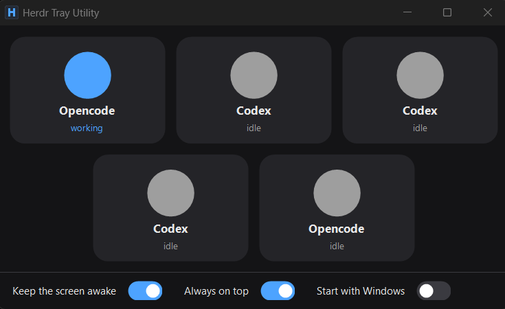

<div align="center">

# Herdr Tray Utility

Herdr agent status in the Windows notification area.

By [alexkutkin](https://github.com/alexkutkin) · [MIT](LICENSE) · Unofficial, not affiliated with Herdr

</div>

A tray icon shows whether your agents are idle, working, waiting for input, or disconnected.
Click it to open a resizable status wall. No installer or account required.

<p align="center">
  
</p>

## Run

Requires **Windows 10 22H2 or Windows 11, 64-bit**, .NET Framework 4.8 or a later
4.x update, and [Herdr](https://herdr.dev/) on PATH. The listed Windows versions
already include a compatible .NET Framework runtime.

1. Download `Herdr Tray Utility-<version>-portable.zip` from this repository's **Releases** tab.
2. Extract the folder and run `Herdr Tray Utility.exe`. Keep the `.exe.config` file next to it.
3. Look in the notification-area overflow if the icon is hidden.

Builds are unsigned, so Windows may warn about an unknown publisher.

**Compatibility:** tested with Herdr **0.9.5** on Windows. The app reads JSON from
[`herdr agent list`](https://herdr.dev/docs/cli-reference/). Other versions have not been verified.

## Use

| Tray icon | Status |
| --- | --- |
| Grey H | Idle |
| Blue H with a dot | Working |
| Amber H with ! | Needs input |
| Red H with x | Cannot read Herdr |

Statuses refresh every two seconds. Agents needing input appear first in the wall.
If the icon stays red, check that `herdr agent list` works in your terminal.

Click the icon to open the wall. Esc or the close button hides it.
Right-click for **Status**, **About** (version and author), or **Exit**.

The wall has three switches, saved as you change them:

- **Keep the screen awake:** on by default, holds the display on while the wall is visible.
  Corporate lock policies still apply.
- **Always on top:** off by default, keeps the wall above other windows.
- **Start with Windows:** off on first use, starts the app when you sign in.
  If you move its folder, launch the EXE again to refresh the startup path.

To update, exit the app and replace its files with the new ZIP contents.
To remove it, disable **Start with Windows**, exit, and delete the folder.
Settings remain in `HKEY_CURRENT_USER\Software\HerdrTray`; delete that key to reset them.
Settings do not travel with the folder.

## Build and package

On Windows, install the [.NET 10 SDK](https://dotnet.microsoft.com/en-us/download/dotnet/10.0)
and [.NET Framework 4.8 Developer Pack](https://dotnet.microsoft.com/en-us/download/dotnet-framework/net48).
Exit the tray app before building.

```powershell
dotnet build -c Debug
dotnet build -c Release
dotnet run -c Debug --no-build
```

To make the release ZIP, run:

```powershell
powershell -ExecutionPolicy Bypass -File scripts\package.ps1
```

This builds both configurations and packages Release into
`dist\Herdr Tray Utility-<version>-portable.zip`, with its config, README and license.
The version comes from `HerdrTray.csproj`, including the version shown in **About**.

For a release, set `<Version>` in the project, package it, and try the extracted ZIP.
Commit and push the matching source revision, then create a GitHub Release with a
matching tag (for example `v1.0.1`) and attach the ZIP. Builds and uploads are manual.

## Tests

Six checks cover builds, ZIP contents, metadata, configuration and version handling:

```powershell
powershell -NoProfile -ExecutionPolicy Bypass -File scripts\verify.ps1
```

Results and logs go to `TestResults`. The app can stay running.
For UI checks, see the [verification skill](.agents/skills/verify-herdr-tray/SKILL.md).
